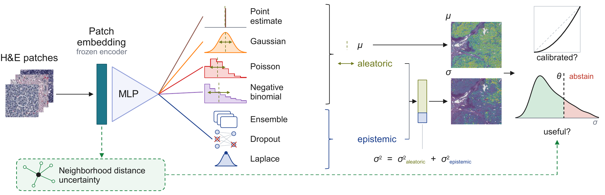

# Uncertainty in virtual spatial transcriptomics

Code for *"Probabilistic uncertainty in virtual spatial transcriptomics from histology is largely redundant with the predicted mean"*: a benchmark of predictive uncertainty for gene expression predicted from H&E, on three Visium cancer cohorts (Tumor Profiler, Kidney/Lung TLS, NSCLC), under leave-one-patient-out training.


## Overview


*Graphical abstract: An MLP maps frozen H&E patch embeddings to the parameters of a predictive distribution. The aleatoric spread comes from the head, the epistemic spread from three epistemic estimators. A training-free neighborhood signal bypasses the model. We assess calibration and usefulness.*

Heads: mean-only, Gaussian (heteroscedastic, gene- and spot-homoscedastic), Poisson, negative binomial, plus the STimage readout. Epistemic: deep ensembles, MC dropout, last-layer Laplace. Baselines: a per-gene marginal fitted without histology, a kNN neighborhood signal, an error oracle.

Two questions are asked of each predictive distribution: is it **calibrated** (PIT calibration metric), and is it **informative**, i.e. does it rank errors beyond what the predicted mean already explains (partial Spearman, sparsification against the oracle).  We found that it is calibrated, but marginally informative beyond the predicted mean.


## Project organization

```
src/                    library of functions used by the scripts
  data/                 preprocessing, datasets, donor-grouped cross-validation splits
  models/               MLP heads, and specs.py, the single source of truth for what
                        varies by model type (class, loss, target, extraction)
  training/             training loops, losses, inference
  evaluation/           slide-aware metrics, PIT calibration, count metrics, kNN uncertainty
  embedding_extraction/ H&E patch cropping and encoder inference

snake/
  Snakefile             To launch the Snakemake sweep: one preprocessing job per cohort, 
                        one training job and post-hoc analysis jobs per (dataset, set of predicted 
                        genes, patch radius, model type, beta-NLL hyperparameter for gaussians)
  config/config.yaml    single source of truth for every experiment parameter
  config/donor_slide_map.yaml   donor to slide mapping, drives the donor-grouped splits
  scripts/              training entrypoints and every post-hoc precompute (see its own README)

snake_search/           the one-off architecture search that fixed the shared MLP trunk
notebooks/              paper_figures/            one notebook per float of the paper
                        three_channels_analysis/  the analysis behind them (see below) 
                        tissue_uncertainty/ synthetic_artifact_response/, reason_for_failure/
                        README.md               every float traced to its notebook, and what
                                                each analysis notebook establishes
data/                   the slide list of each cohort, one name per line. The gene embeddings
                        the gene-conditioned model needs also live here; they are not tracked
results/                written by the runs, not tracked by git: one directory per run,
                        plus the preprocessed data shared by all of them (see 5. Outputs)
setup.py                installs src/ as an importable package
```

The paper reports a classic architecture, with one output head per gene. A gene-conditioned model (GCM), which predicts unseen genes from a gene embedding, is also provided; it performed worse and is not reported in the paper, but is left for potential use in the code.

## How to start

### 1. Environment

```bash
conda env create -f environment_mtenv0_minimal.yml
conda activate mtenv0
pip install -e .
```

`mtenv0` runs the training and the analysis. Every compute job uses it. On a host with no NVIDIA driver, a login node for instance, prefix the create with `CONDA_OVERRIDE_CUDA=12.8`.

`environment_snaky.yml` is a second, much smaller environment. It only builds the job graph and submits it. It does not need PyTorch.

`environment_mtenv0_minimal.yml`, used above, lists the packages the code imports and lets conda pick the versions. It installs a newer stack than the one the results came from: pandas 3 rather than pandas 2.3.

`environment_mtenv0.yml` is the full export of the environment the reported numbers were produced in, pinned to exact versions. Install it instead to reproduce that exact stack.

### 2. Data

The three cohorts are not distributed with this repository.

| Cohort | Composition | Where to get it |
|---|---|---|
| Tumor Profiler | 18 FFPE sections, 7 patients, metastatic melanoma. Expert spot annotations: Tumor, Normal lymphoid tissue, Blood/Necrosis, Stroma, Pigment | On request from the Tumor Profiler Consortium, <https://tumorprofilercenter.ch/contacts>. Described in *Bioinformatics* 2026, [doi:10.1093/bioinformatics/btag316](https://doi.org/10.1093/bioinformatics/btag316) |
| Kidney/Lung TLS | 6 FFPE sections, 6 patients, kidney and lung tumors rich in tertiary lymphoid structures. Expert annotations: TLS, Immune, Tumor, Normal, Lymph node, Unassigned. Two further slides exist but are excluded for lower quality | Zenodo, [doi:10.5281/zenodo.14620362](https://doi.org/10.5281/zenodo.14620362) |
| NSCLC | 36 fresh-frozen sections, 8 patients. 5 adenocarcinoma and 3 squamous cell carcinoma; 20 tumor sections and 16 matched non-involved | ArrayExpress, accession `E-MTAB-13530`. De Zuani et al., *Nature Communications* 2024, [doi:10.1038/s41467-024-48700-8](https://doi.org/10.1038/s41467-024-48700-8) |

All three are 10x Visium, with 77,338, 19,437 and 68,659 spots. Each cohort is reduced to its 3,000 most variable genes.

The models do not read the images. They read one embedding vector per spot, produced beforehand by `snake/scripts/embeddings_extraction/`. `extract_clean_embeddings.py` does this, one invocation per cohort. Its `--suffix` has to match the `emb_subdir` set in the config, or preprocessing will not find what it wrote. The encoder is frozen: [`kaiko-ai/midnight`](https://huggingface.co/kaiko-ai/midnight), revision `adc6b15679c981cce6f9b018bbad09d16eeeda9f`. The scripts read it from the local HuggingFace cache, or from the directory given by `--model-path`.

The other `extract_*.py` scripts rebuild the same embeddings from deliberately degraded images. That is the corruption experiment, not a required step.

### 3. Configuration

`snake/config/config.yaml` is the only file to edit. It is a good starting point and contains the different parameters of the pipeline. It explicitly maps the cohort, model and metric names used in the paper. 4 of its keys are `/path/to/...` placeholders.

| key | set it to |
|---|---|
| `project_root` | the repository root, the directory holding `src/` and `snake/` |
| `parent_dir` | the directory holding one cohort of slides, one `.h5ad` file per slide |
| `emb_base_dir` | the directory where that cohort of patch embeddings was written |
| `samples_file` | a text file listing that cohort of slides, one name per line |

The last three are set once per cohort, so nine values in total. `snake_search/config.yaml` has a `project_root` of its own.

The embedding extraction scripts are the exception: each carries its own per-cohort `parent_dir` and `emb_base_dir` at the top of the file, since they run before the pipeline exists. Set those the same way.

Nothing else takes a path. Scripts and launchers find the repository from their own location on disk. Notebooks find it from the directory their kernel was started in, so that kernel has to be started inside the repository.

### 4. Run

The pipeline is a Snakemake workflow. It creates one job per (cohort, gene set, patch radius, model type, beta-NLL value). The beta-NLL exponent is spelled `lambda` in the code: the config key is `lambda_values` and the path segment is `lambda_{value}`.

```bash
snakemake --snakefile snake/Snakefile --configfile snake/config/config.yaml \
  --profile snake/profile  all_classic
```

The last argument is the target, that is, what to build:

| target | builds |
|---|---|
| `all_classic` | the main sweep: every model on every cohort, then the analysis of each run |
| `all_gcm` | the same for the gene-conditioned model |
| `all` | both |
| `all_ensemble_classic` | the deep ensembles, and their analysis |
| `all_train_ensemble_classic` | the ensemble members alone, without the analysis |
| `all_preprocess` | the preprocessed data alone |

Preprocessing is not a separate step. Each training job declares the preprocessed file as an input, so Snakemake builds it first. Eleven further targets exist for single stages; `snake/Snakefile` lists them.

`snake/profile/config.yaml` holds the command that submits a job to the cluster. It is written for SLURM. On another scheduler, that one file is what changes.

Two version labels in the config control where outputs land: `preproc_id` for the preprocessing, `run_id_classic` for the training. Changing either writes a fresh set of outputs instead of overwriting the previous one.

Every number in the paper comes from the hyperparameters set in `snake/config/config.yaml` as it stands. The one exception is the STimage benchmark, which is trained with the recipe of its own paper: those overrides go in `ensemble.classic.hyperparams`, which replaces the top-level training keys for ensemble members. That block applies to a whole run, so the benchmark is a run of its own rather than another head in the main one.

### 5. The uncertainties computed after training

The sweep gives every model its own predicted uncertainty. Four further sources are added on top of it, and all four need the sweep to have finished. MC-dropout and Laplace reload the checkpoints it wrote; the kNN signal trains nothing and reads only its splits and its predictions; the deep ensemble is a retraining of five seeds, which is why it is a Snakemake target rather than a post-oc launch script.

| source | compute it with | score it with |
|---|---|---|
| the model's own predicted uncertainty | the sweep itself | `canals/launch_canal2_precompute.sh` |
| MC-dropout | `epistemic/launch_epistemic.sh` | `canals/launch_canal2_epistemic_precompute.sh` |
| last-layer Laplace | the same launcher, which submits it as its own separate job | `canals/launch_canal2_laplace_precompute.sh` |
| kNN, read off each spot's neighbors, with no training at all | `epistemic/launch_knn_uncertainty_precompute.sh` | `canals/launch_canal2_knn_precompute.sh` |
| deep ensemble | the `all_ensemble_classic` target above | `canals/launch_canal2_ensemble_precompute.sh` |

Those paths are relative to `snake/scripts/`.

MC-dropout and Laplace each write a `test_summaries.h5ad` inside the directory of the run they read, under `mc_dropout/` and `laplace/`; section 6 below gives that directory. They are two jobs and never one, because Laplace costs an order of magnitude more than MC-dropout and chaining them would make the cheap one wait on the slow one. The kNN signals go to `results/_analysis/knn_uncertainty/`.

The header of each script lists its options and what it needs in place first. `snake/scripts/README.md` gives the one-line purpose of every script in the tree.

### 6. Outputs

One directory per run, under `results/{cohort}/{run_id}/{gene_set}/r{NN}/{model_type}/`, where `r75` is the patch radius 0.75. The Gaussian heads add a `lambda_{value}/` level for the beta-NLL exponent, so their leaf is one deeper.

| file | holds |
|---|---|
| `metrics.json` | the hyperparameters, the provenance, and the headline number averaged over held-out patients |
| `predictions/preds_fold{k}.h5ad` | the predictions of one fold, with the keys to join them back to the input data |
| `atoms.parquet` | one row per (fold, split, slide, gene): the statistics the headline number is averaged from. Validation and test are stacked over every fold, so filter on `split` and `fold` before aggregating |
| `splits.json` | which patients were in train, validation and test, per fold |
| `learning_curves/` | one row per epoch |

Next to them, the analysis writes small summary tables. It is split into three independent channels. The directory `snake/scripts/canals/` is named after them; `canal` is simply the French for channel.

| channel | question | writes |
|---|---|---|
| 1. Performance and calibration | Is the predicted mean accurate, and is the predicted distribution calibrated? | `benchmark_summary.json`: per-(patient, gene) correlation, error, and calibration |
| 2. Informativeness | Does the uncertainty rank the errors, beyond what the predicted mean already explains? | `canal2_uncertainty/summary.json`: correlations with and without the mean controlled for, and sparsification curves |
| 3. Zero detection | Does the model know which measurements are true zeros? | `canal3_zero_detection/summary.json`: per-(gene, slide) AUROC against the observed zeros |

Channels 1 and 2 carry the paper. Channel 3 runs by default and writes its outputs, but the paper does not report it.
The notebooks read those summary tables. `notebooks/README.md` traces every figure and table of the paper to the notebook that produces it, and says which analysis has to be run first.

## Using the metrics on your own predictions

The metrics do not depend on the models here. Given predictions from any source, the same functions can be used to compute the numbers the paper reports.

`notebooks/reproducing_the_numbers_on_any_predictions.ipynb` does it end to end on one spatial transcriptomics slide. That slide comes from a run of this repository: replace its first cell with your own arrays and the rest is unchanged. It rebuilds every number of the paper at that scale: the accuracy, the calibration, the informativeness on both axes with and without the predicted mean controlled for, and the sparsification curve. A last section shows how those per-slide numbers are folded into a cohort headline and its interval across patients. It calls the functions of `src/evaluation/` directly and recomputes everything from the predictions, rather than reading what the pipeline analysis scripts produced, so the notebook is a single readable file pointing at the code it uses.

Throughout here, everything is computed per (slide, gene) first, then averaged. Pooling every spot of every slide into one correlation lets the differences between slides carry the score. The aggregation logic is specified at the end of the notebook. 

